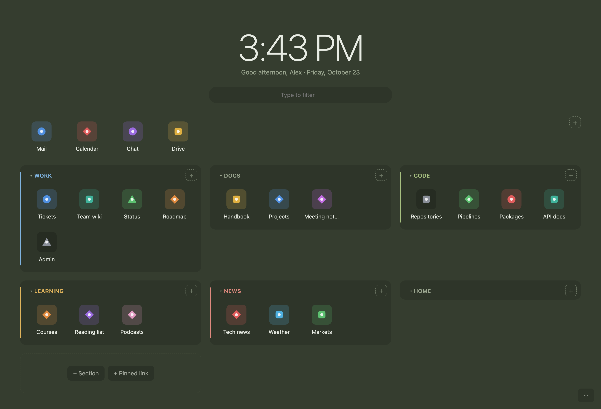

# Start Tab



A full-screen new tab page for Chromium browsers (Chrome, Edge, Brave, Helium and others), built from a bookmarks folder.

Chromium's own new tab page caps shortcuts at 10. Start Tab turns a bookmarks folder named **Start** into as many sections of tiles as you like. Because the links are ordinary bookmarks, they back up and sync with your browser profile, and you can manage them from the page or from the bookmark manager.

## Features

- **Sections from folders:** each subfolder of Start is a titled section of tiles. Links placed directly in Start form a pinned row at the top.
- **Edit on the page:** add, edit, remove and drag to reorder links and sections. Every change is written straight to your bookmarks.
- **Live updates:** changes made in the bookmark manager, or in another tab, appear immediately.
- **Clock and greeting** at the top, with an optional name.
- **Type to filter:** start typing anywhere to narrow the tiles, then press Enter to open the first match.
- **Section colours** and **collapsible sections**.
- **Tinted icons:** each tile picks up a soft background from its site's favicon.
- **Compact or comfortable** tile density.
- **Light and dark** themes, following your system setting.
- **Private by design:** no network requests, analytics or remote code. See [PRIVACY.md](PRIVACY.md).

## Install

### From source (sideload)

1. Download or clone this repository.
2. Open `chrome://extensions` and turn on **Developer mode**.
3. Click **Load unpacked** and choose the `src` folder.
4. Open a new tab. If the browser asks whether to keep the changed new tab page, choose **Keep**.

After changing code, click the reload icon on the extension's card.

## Organising your bookmarks

The page shows one bookmarks folder named **Start** and mirrors its order exactly. If there is no Start folder yet, the page offers a button to create one.

```
Other bookmarks (or Bookmarks bar, anywhere works)
└── Start                      ← must be named exactly "Start"
    ├── Mail                   ← links directly in Start = pinned row at the top
    ├── Work                   ← each subfolder = a section, in this order
    │   ├── Calendar           ← tiles, in this order
    │   └── Team wiki
    ├── Docs
    │   ├── Handbook
    │   └── Projects           ← a folder inside a section shows as its own
    │       └── ...               section, titled "Docs / Projects"
    └── News
```

- **Section order** follows the order of the subfolders in Start.
- **Tile order** follows the order of the bookmarks in each folder.
- **Links directly in Start** always show as the top row, wherever they sit in the folder.
- **Folders inside a section** appear after that section as their own section, titled `Parent / Child`.
- **Keep only one folder named "Start".** If there are two, the page uses the first one the browser finds.

## Using the page

### Editing

- **Right-click a tile:** Open in new tab, Edit (name and URL), or Remove. A removed link can be restored with **Undo** for a few seconds.
- **Right-click a section title:** Add link, Rename, Colour…, Add section inside, or Remove section (asks first, and removes its links too).
- **+ button** in the top-right corner of a section adds a link to it.
- **+ Section / + Pinned link** card at the end of the page adds a new section, or a link to the pinned row.

### Drag and drop

- **Drag a tile** onto another tile to place it before or after it, or onto a section's empty space to add it at the end. This works across sections.
- **Drag a section title** onto another section to reorder sections.
- **Drag a link** from the address bar or a web page onto a section to bookmark it there.

### Navigating

- **Type anywhere** to filter. Enter opens the first match, Cmd/Ctrl+Enter opens it in a background tab, and Escape clears the filter.
- **Click a section title** to collapse or expand it. Filtering still searches collapsed sections.

### Settings

The **⋯** button in the bottom-right corner opens settings:

- **Set your name** for the greeting.
- **Compact / Comfortable tiles.**
- **Bookmark manager** opens straight to the Start folder.

Name, section colours, collapsed sections and density are saved in the browser's extension storage (`chrome.storage.sync`). Links and sections always come from your bookmarks.

### Shortcuts

| Action | macOS | Windows / Linux |
| --- | --- | --- |
| Bookmark the current page | Cmd+D | Ctrl+D |
| Open the bookmark manager | Cmd+Option+B | Ctrl+Shift+O |

## Permissions

| Permission | Why |
| --- | --- |
| `bookmarks` | Read the Start folder and save edits made on the page |
| `favicon` | Show site icons from the browser's local favicon cache |
| `storage` | Remember page settings |

## Development

The extension is plain HTML, CSS and JavaScript in `src/`, with no build step and no dependencies.

- `scripts/package.sh` builds `dist/start-tab-<version>.zip` for the Chrome Web Store. Bump `version` in `src/manifest.json` before each upload.
- `scripts/make_icons.py` regenerates the icons (needs Pillow).
- `docs/store-screenshot-1280x800.png` is sized for the Chrome Web Store listing. Screenshots use example bookmarks and generic icons.

## License

[MIT](LICENSE)
